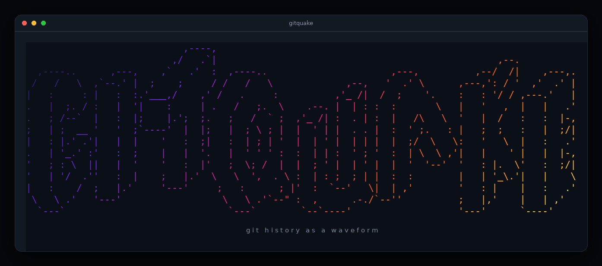
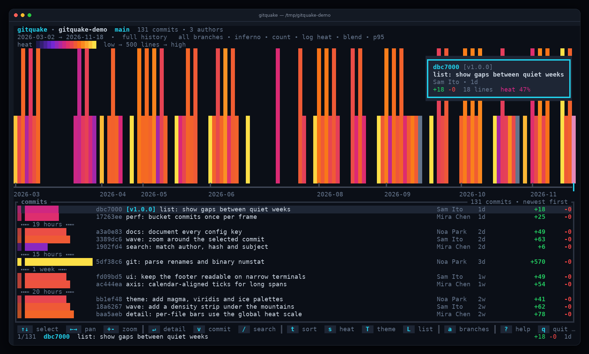
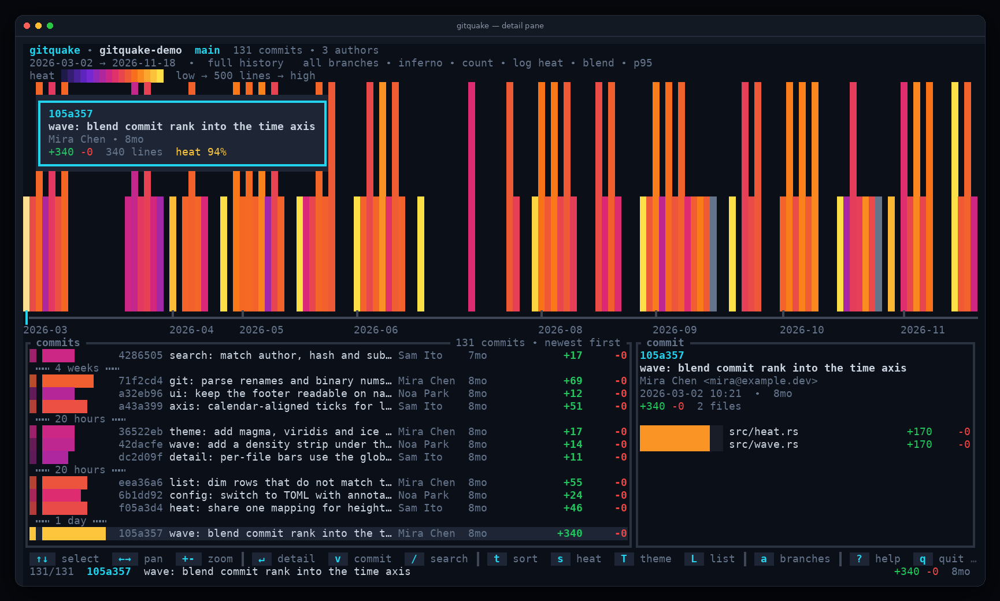

<p align="center">
  
</p>

<p align="center">
  <b>Git history, as a waveform.</b><br>
  Each column is a slice of history. Height is how many commits landed; colour is how
  many lines changed.
</p>

<p align="center">
  
  
</p>



`gitquake` turns a repository's history into a full-screen waveform. Time runs left
to right, each column collects the commits from one slice of it, and quieter weeks
become valleys while a day of refactoring becomes a ridge. Instead of reading
`git log --graph` line by line, you get the shape of the project at a glance — and
can still drill into any commit.

It is a terminal UI built with Rust and ratatui. No libgit2: the whole history is read
with one `git log --numstat` call.

## Why it looks like this

- **Time is the x axis.** Long gaps are visibly long. A burst of commits is a cluster,
  not just more lines in a list.
- **Height is activity.** A column is as tall as the number of commits that landed in
  it. The scale is piecewise (bands double: 1, 2, 4, 8, …), so 100 and 150 commits stay
  visibly different instead of saturating against one huge week.
- **Colour is impact.** The colour of a column is the total `insertions + deletions`
  for every commit in it, normalised against the 95th percentile and mapped through a
  log curve. A busy week and a heavy week are two different things.
- **The list is still there.** Every bar has a row with refs, author, age and `+/-`;
  selecting a commit draws a card over the wave and a detail pane below or beside it.
- **Nothing is hidden by search.** Matching commits stay bright and everything else
  dims, so you keep the surrounding history while you look for one change.
- **It is a real terminal app.** Mouse, themes, zoom, sorting, a full patch viewer and
  a plain mode for pipes.

## Install

```sh
cargo install --path .
# or
cargo build --release && ./target/release/gitquake
```

Requires `git` on `PATH` and Rust 1.85 or newer to build.

## Usage

```sh
gitquake                     # current repository
gitquake ~/src/thing         # any path inside a repository
gitquake --all               # every branch, not just HEAD
gitquake -n 500              # only the newest 500 commits
gitquake --since 2024-01-01  # git --since syntax
gitquake --author ada        # filter by author
gitquake --no-merges         # skip merge commits
gitquake --theme viridis --scale linear
gitquake --plain             # static output, safe for pipes/pagers
gitquake --plain --no-color | less
gitquake --dump-config       # print the effective config
gitquake --list-themes
```

When stdout is not a terminal, `gitquake` automatically uses plain mode. Colours
degrade from truecolor to 256 to 16 colours depending on `COLORTERM` / `TERM`; use
`--color` or `--no-color` to force the issue.

## Keys

| key | action |
| --- | --- |
| `↑` `↓` / `k` `j` | select previous / next commit |
| `PgUp` `PgDn` | page through the list |
| `g` `G` / `Home` `End` | oldest / newest |
| `←` `→` / `h` `l` | pan the window |
| `+` `-` | zoom in / out around the selection |
| `0` / `Esc` | reset zoom |
| `↵` | toggle the detail pane (side-by-side when wide) |
| `v` | open the full commit record: message, stat and patch |
| `/` | search; non-matching commits are dimmed, not hidden |
| `n` `N` | next / previous match |
| `t` | sort: newest → largest → smallest |
| `s` | toggle log / linear heat |
| `a` | all branches / current branch |
| `T` | cycle themes |
| `L` | hide / show the commit list |
| `R` | reload config and repository |
| `m` | toggle mouse |
| `?` | help overlay |
| `q` / `Ctrl-C` | quit |

Esc also clears an applied search (or closes the current overlay). Clicking a bar
selects its commit, clicking a list row selects it, and the wheel scrolls the list.

## Reading the screen

### The waveform

Each column is a slice of history, and its height is the number of commits inside that
slice. Heights are drawn with eighth blocks (`▁▂▃▄▅▆▇█`) for sub-cell precision.

Counts use a piecewise scale. Bands double — `0–1`, `1–2`, `2–4`, `4–8`, … up to the
largest count currently visible — and every band gets the same vertical space, with a
linear ramp inside the band. That makes `100` and `150` commits visibly different
instead of both flattening near the top of a smooth curve. Only visible columns are
measured, so zooming or panning never pays for history that is off screen.

Colour is a separate value: the sum of `insertions + deletions` for every commit in
the column, interpolated over the theme's five-stop heat ramp and normalised against
the 95th percentile of single-commit volumes. The legend in the header shows the
current ramp and reference:

```
heat ████████████████  low → 500 lines → high
```

There is no separate density strip: height already is density, and colour is volume.
A column made only of merges still has height, because merges are part of the
history, but it stays dim because git reports no diffstat for them.

The x axis has two modes:

- **`blend`** *(default)* — half wall-clock, half commit order. A burst of 30 commits in
  one evening stays readable while quiet stretches still take room.
- **`time`** — strictly proportional to wall-clock time.

Axis labels follow the mode: calendar boundaries in `time`, evenly spaced commits in
`blend`. Zoom changes the window around the selected commit; pan moves it. A floating
card shows the selected commit over the wave.

### The commit list

Rows are compact: heat glyph, heat bar, hash, refs, subject, author, age and `+/-`.
Merged commits get a `⑂` prefix and a thin dim bar. If nothing happened for longer
than `gap_hours`, a separator like `┄┄ 10 days ┄┄` marks the quiet stretch.

### The detail pane



Press `↵` to open it. On wide terminals it sits to the right of the list; on narrow
ones it moves below. It shows the commit header, author, absolute and relative time,
merge parents, totals, and one proportional bar per changed file. All file bars use
the same global heat reference as the main waveform, so file sizes stay comparable
between commits.

### The full commit

Press `v` on a selected commit to open a full-screen viewer with the complete commit
record: hash, author and committer dates, the whole message, `--stat`, and the patch
with green/red hunks. Scroll with `j`/`k` or `PgUp`/`PgDn`, jump with `g`/`G`, and
close with `v`, `q` or `Esc`; closing the viewer leaves `gitquake` running.

Patches are capped at 8000 lines and end with a truncation marker. The same data is
available directly:

```sh
git show <hash>          # header + message + patch
git show --stat <hash>   # summary only
```

## How the waveform is computed

### Height — commits per column

- Commits are bucketed into terminal columns using the current axis projection.
- `CountScale` builds bands from the largest **visible** bucket: `0–1`, `1–2`, `2–4`,
  `4–8`, … up to that maximum, each occupying an equal share of the waveform height.
- Within a band the height is linear, so values close together inside a band remain
  distinguishable. With a maximum of 150, a column of 100 commits sits around 84% of
  full height and 150 reaches 100%.
- Off-screen commits are excluded from both the bucket loop and the maximum, so a
  narrow zoom stays cheap even in a very large repository.

### Colour — change volume per column

- **Value** — for each column, the sum of insertions + deletions over all commits in
  it. Binary files count as zero.
- **Reference** — the 95th percentile of **single-commit** volumes
  (`heat_percentile`), not the maximum, so one imported vendor dump cannot flatten
  everything else.
- **Mapping** — `log(1 + value) / log(1 + reference)`, then an optional gamma
  (`heat_gamma`). `heat_scale = "linear"` switches to plain proportion.
- **Shared scale** — the compact list bars and the per-file bars in the detail pane use
  the same reference and mapping, so a file can be compared with the wave and with
  other commits.
- **Merges** — git reports no diffstat for them, so they add height but no colour; a
  merge-only column is drawn in the dim role. In the list they are prefixed with `⑂`
  and labelled `merge`.

## Configuration

`gitquake` reads `~/.config/gitquake/gitquake.toml` (XDG aware), creates it with
annotated defaults on first run, and reloads it with `R`. Override the location with
`--config FILE` or `GITQUAKE_CONFIG`; skip it with `--no-config`.

The config is plain TOML. Every field is optional; unknown keys produce a warning in
the header (`⚠ n config warnings`) instead of aborting.

```toml
[general]
theme = "inferno"          # built-in name, custom theme name, or a path
limit = 5000               # 0 = all commits
all_branches = false
relative_time = true       # false -> use date_format
date_format = "%Y-%m-%d"
mouse = true
wave_height = 0.55         # fraction of the body given to the waveform
wave_axis = "blend"        # blend | time
heat_scale = "log"         # colour mapping: log | linear
heat_percentile = 95       # reference percentile for colour
heat_gamma = 1.0
glyphs = "eighth"          # eighth | block | ascii
bar_width = 20
row_fields = ["heat", "bar", "hash", "refs", "subject", "author", "time", "diff"]
detail_layout = "auto"     # auto | side | bottom
gap_hours = 12             # insert a gap separator when idle this long

[colors]
heat_low = "#1e1b4b"
heat_1 = "#6d28d9"
heat_2 = "#db2777"
heat_3 = "#f97316"
heat_high = "#fde047"
# fg, dim, accent, ok, bad, warn, axis, border, selected_bg, wave_peak

[keys]
zoom_in = "+"
zoom_out = "-"
view_commit = "v"
help = "?"
# any action name from the key table above
```

`row_fields` controls the list layout and its drop order: fields are removed from the
right (refs first) until the subject still has room. `glyphs = "ascii"` falls back to
`_-|` marks for terminals without block characters.

### Themes

Built in: `inferno`, `magma`, `viridis`, `ice`, `mono`, `solarized`.

Custom themes are TOML files in `~/.config/gitquake/themes/<name>.toml`:

```toml
# ~/.config/gitquake/themes/neon.toml
[colors]
heat_low = "#101322"
heat_high = "#ffd166"
accent = "#ffd166"
```

Colour keys can also sit at the top level of the file. `gitquake --list-themes` prints
the built-in ramps and the theme directory.

## Plain mode

`--plain` (or piping) prints a header, a 10-row waveform, the axis, and the commit list
with ANSI colours. It is deterministic: no alternate screen, no mouse, no timers.
Useful for `less -R`, CI logs, screenshots, or embedding in other tools.

## Development

```sh
cargo test          # unit tests + end-to-end CLI tests in a temp repo
cargo build --release
cargo clippy --all-targets
```

Source layout:

```
src/git.rs      git log invocation + numstat parser
src/model.rs    Commit / Repo / refs
src/stats.rs    percentile, normalisation, projection, buckets, ticks
src/rows.rs     shared commit-row renderer (TUI + plain)
src/theme.rs    ramps, role colours, colour-depth degradation
src/config.rs   config parsing, defaults, key maps
src/ui/         waveform, list, detail, chrome, help, event loop, viewer
src/plain.rs    non-interactive rendering
```

The logo is `asset/ascii.txt` rendered with the inferno ramp; the screenshots are
captured from a demo repository with 131 commits across three branches.

## License

MIT — see [LICENSE](LICENSE).
